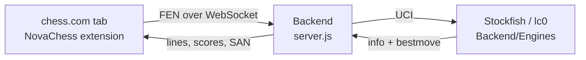

<a name="top"></a>
<p align="center">
  
</p>

<p align="center">
  <a href="https://developer.chrome.com/docs/extensions/develop/migrate/what-is-mv3"></a>
  <a href="https://nodejs.org"></a>
  <a href="https://github.com/official-stockfish/Stockfish"></a>
  
  
  <br>
  <a href="https://github.com/ntcopy/NovaChess/stargazers"></a>
  <a href="https://github.com/ntcopy/NovaChess/commits"></a>
  <a href="https://github.com/ntcopy/NovaChess/issues"></a>
  <a href="https://discord.gg/FE3G2BZ5pC"></a>
</p>

<p align="center">⭐ Star the repo if NovaChess is useful to you. It helps a lot. 🙏</p>

NovaChess puts a local Stockfish analysis overlay on top of chess.com **games**, and lets you restyle the board with custom themes. A small Node server runs the engines on your own machine; a Chrome extension draws the arrows, eval bar and panel.

## Table of Contents
- [About](#-about)
- [Quickstart](#-quickstart)
- [How it works](#-how-it-works)
- [Setup](#-setup)
  - [1. Install the server](#1-install-the-server)
  - [2. Add the engine binaries](#2-add-the-engine-binaries)
  - [3. Configure engines (the `ENGINES` struct)](#3-configure-engines-the-engines-struct)
  - [4. Load the extension](#4-load-the-extension)
- [Usage](#-usage)
- [Configuration](#-configuration)
- [Troubleshooting](#-troubleshooting)
- [Fair play](#-fair-play)
- [Community](#-community)

## 🚀 About

- **Local and private**: analysis runs on your CPU through a WebSocket bound to `127.0.0.1`. Nothing is sent to a third-party service.
- **Multiple engines**: Stockfish 17, 18 and 19 out of the box, with an optional Leela Chess Zero (lc0) entry.
- **Readable overlay**: best-move arrows, square highlights, an eval bar and a draggable panel with principal variations in SAN.
- **Tunable**: number of candidate moves, search by time or depth, per-feature toggles, and optional autoplay in bot games.
- **Board themes**: presets (midnight, forest, walnut, rose, ocean, neon, slate, sand), custom colors, board texture, corner radius, coordinates, page background and your own CSS.

## ⚡ Quickstart

```shell
git clone https://github.com/ntcopy/NovaChess.git
cd NovaChess/Backend
npm install
# put stockfish17.exe / stockfish18.exe / stockfish19.exe in Backend/Engines (see below)
npm start
```

Then open `chrome://extensions`, enable **Developer mode**, click **Load unpacked** and select the `extension` folder. Open a chess.com [game](https://www.chess.com/play/).

## 🧩 How it works



The extension reads the position from the chess.com board, sends the FEN to the server, and draws whatever comes back. The server owns the engine processes and speaks UCI to them.

## 🛠 Setup

**Requirements:** [Node.js 18+](https://nodejs.org), Google Chrome (or another Chromium browser that supports MV3 extensions), and at least one engine binary.

### 1. Install the server

```shell
cd Backend
npm install
```

### 2. Add the engine binaries

The server looks for engines in **`Backend/Engines`**, and each file must follow this naming scheme:

```
stockfish(version).exe
```

For the three bundled Stockfish entries to work, the folder has to contain exactly these files:

```
Backend/
├─ server.js
└─ Engines/
   ├─ stockfish19.exe
   ├─ stockfish18.exe
   └─ stockfish17.exe
```

> [!IMPORTANT]
> An engine only works if its file exists at the path in the `ENGINES` struct. A missing file means that engine fails to start. If you don't want all three, disable the ones you don't have (see [step 3](#3-configure-engines-the-engines-struct)).

#### Where to get Stockfish

1. Go to the official releases: <https://github.com/official-stockfish/Stockfish/releases> (or <https://stockfishchess.org/download/>).
2. Open the release for the version you want (for example the `sf_19` tag) and download the archive for your OS and CPU.
3. Extract it and find the engine executable inside.
4. Copy that executable into `Backend/Engines` and **rename it** to `stockfish<version>.exe`, e.g. `stockfish19.exe`.
5. Repeat for the other versions you want.

**Choosing a build.** Release assets are named per OS and CPU feature set, for example `stockfish-windows-x86-64-avx2`. As a rule of thumb, pick the most capable build your CPU supports:

| Build | Pick it when |
| --- | --- |
| `x86-64-avx2` | Safe default for most CPUs from the last decade |
| `x86-64-bmi2` | Recent Intel and AMD Zen 3+ CPUs (usually a bit faster than avx2) |
| `x86-64-avx512` / `vnni512` | Only if your CPU supports AVX-512 |
| `x86-64` | Very old CPUs, slowest |

If a build crashes immediately or prints "illegal instruction", your CPU doesn't support it. Step down to a more compatible one. Asset names change between releases, so check the release page for the current list. For more on downloading and usage see the [Stockfish wiki](https://official-stockfish.github.io/docs/stockfish-wiki/Download-and-usage.html).

> [!NOTE]
> The `.exe` naming is Windows-oriented. On Linux or macOS, keep any filename you like and change the `path` in the `ENGINES` struct to match (and make sure the file is executable with `chmod +x`).

### 3. Configure engines (the `ENGINES` struct)

Engines are declared in the `ENGINES` object in `Backend/server.js`:

```js
const ENGINES = {
  stockfish19: {
    name: 'Stockfish 19',
    path: process.env.STOCKFISH_PATH || 'Engines/stockfish19.exe',
    args: [],
    protocol: 'uci',
    options: { Threads: THREADS, Hash: HASH_MB },
  },
  stockfish18: {
    name: 'Stockfish 18',
    path: 'Engines/stockfish18.exe',
    args: [],
    protocol: 'uci',
    options: { Threads: THREADS, Hash: HASH_MB },
  },
  stockfish17: {
    name: 'Stockfish 17',
    path: 'Engines/stockfish17.exe',
    args: [],
    protocol: 'uci',
    options: { Threads: THREADS, Hash: HASH_MB },
  },
  lc0: {
    name: 'Leela Chess Zero',
    path: 'Engines/lc0.exe',
    args: [],
    protocol: 'uci',
    options: {},
    enabled: false,
  },
};
```

**Don't want all three Stockfish versions?** Disable the ones you aren't using by adding `enabled: false` to their entry (or delete the entry). For example, to run Stockfish 19 only:

```js
stockfish18: {
  name: 'Stockfish 18',
  path: 'Engines/stockfish18.exe',
  args: [],
  protocol: 'uci',
  options: { Threads: THREADS, Hash: HASH_MB },
  enabled: false,   // <- disabled, no binary needed
},
```

**Renamed an executable?** The file name and the struct have to agree. If you rename `stockfish19.exe` to, say, `sf19-avx2.exe`, update its `path` in `server.js` to `'Engines/sf19-avx2.exe'`. Changing the file name without changing the struct (or the other way round) is the most common reason an engine won't start.

**Enabling Leela (lc0).** Put `lc0.exe` in `Backend/Engines`, point `args` at your network (for example `['--weights=Engines/your-network.pb.gz']`), and remove `enabled: false`. lc0 needs a network file and works best with a GPU backend.

### 4. Load the extension

1. Start the server with `npm start` in `Backend`. You should see it listening on `ws://127.0.0.1:8765`.
2. In Chrome go to `chrome://extensions` and turn on **Developer mode**.
3. Click **Load unpacked** and choose the `extension` folder (the one containing `manifest.json`).
4. Pin NovaChess to the toolbar if you want quick access to the popup.

## 🎮 Usage

1. Keep the server running in a terminal.
2. Open a chess.com [bot game](https://www.chess.com/play/computer) or the [analysis board](https://www.chess.com/analysis). The overlay attaches to the board automatically.
3. Use the **⚙** button on the overlay to change the number of moves shown, search by time or depth, and toggle arrows, highlights, the eval bar and PV lines. The panel can be dragged anywhere.
4. Turn on **Autoplay** to have the best move played for you in bot games (it is only available on bot-game pages).
5. Click the toolbar icon to open the popup: set the server URL on the **Engine** tab, and pick or build a board look on the **Theme** tab.

## ⚙ Configuration

Server settings come from environment variables:

| Variable | Default | Description |
| --- | --- | --- |
| `PORT` | `8765` | WebSocket port |
| `HOST` | `127.0.0.1` | Bind address. Keep it local unless you know why you need otherwise |
| `STOCKFISH_PATH` | `Engines/stockfish19.exe` | Overrides the path of the `stockfish19` entry |
| `THREADS` | `2` | Engine threads |
| `HASH` | `256` | Engine hash size in MB |
| `ALLOWED_ORIGINS` | `chess.com,localhost` | Origins allowed to connect |
| `TLS_CERT` / `TLS_KEY` | unset | Serve `wss://` instead of `ws://` |

PowerShell example:

```powershell
$env:THREADS = 8; $env:HASH = 1024; npm start
```

## 🩺 Troubleshooting

- **"Server offline, retrying"**: make sure `npm start` is running and the popup's server URL matches (`ws://127.0.0.1:8765` by default). Newer versions of Chrome may show a **local network access** prompt for chess.com; click **Allow**, or enable it under the site's permissions.
- **An engine doesn't start**: check that the file exists in `Backend/Engines` with the exact name in the `ENGINES` struct, or disable that entry.
- **"illegal instruction" or an instant crash**: your CPU doesn't support that Stockfish build. Download a more compatible one (for example `avx2`).
- **Theme doesn't change the board**: open the popup's **Theme** tab, scroll to **Troubleshooting** and click **Inspect board**, then use **Copy** and include the report in an issue.
- **No overlay**: it only runs on `/play/computer`, `/game/computer` and `/analysis` pages. Reload the tab after loading or updating the extension.

## ⚖ Fair play

NovaChess is intended for **bot games and analysis**. Using engine assistance in games against other people breaks chess.com's fair play rules and can get your account closed. Please don't.

## 💬 Community

- 🐛 Bugs and feature requests: [GitHub Issues](https://github.com/ntcopy/NovaChess/issues)
- 💬 Chat and support: [Discord](https://discord.gg/FE3G2BZ5pC)

<p align="right"><a href="#top">⬆ Back to top</a></p>
